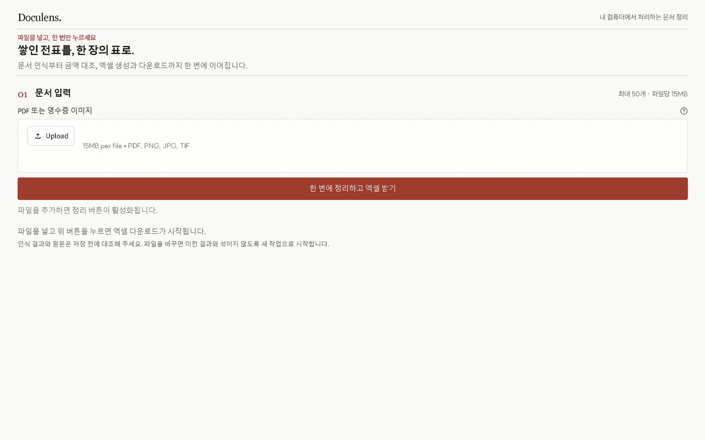
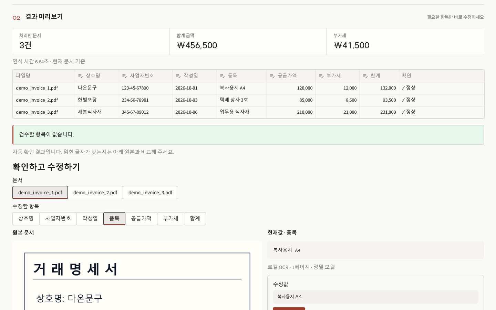
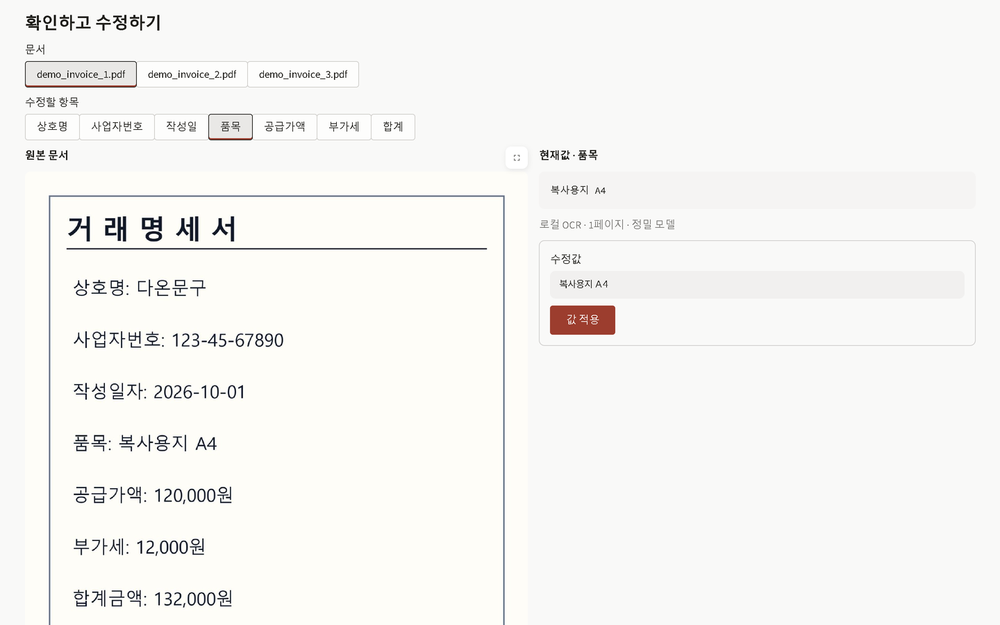

# DOCULENS

사용법 영상: [롱폼](https://www.youtube.com/watch?v=M3cKhZBobt0) · [쇼츠](https://www.youtube.com/shorts/fkdBdLUzH8E)

PDF·이미지 명세서를 로컬에서 읽고 검토한 뒤 XLSX 표로 내보내는 업무 도구입니다.

## 화면

## 설치

1. Python 3.10 이상과 Tesseract OCR 엔진, Poppler를 설치합니다.
2. `python -m venv .venv`를 실행하고 가상환경을 활성화합니다.
3. `python -m pip install -r requirements.txt`를 실행합니다.
4. `python setup_models.py`를 실행해 고정된 정밀 한국어·영어 OCR 모델(약 28 MB)을 설치합니다. 모델은 Apache-2.0 라이선스입니다.

## 사용

1. `run.cmd`(Windows) 또는 `./run.sh`(macOS/Linux)를 실행합니다.
2. 가상 예시를 선택하거나 PDF·이미지 파일을 불러옵니다.
3. 원본과 결과를 대조·수정하고 XLSX로 내려받습니다.

## 한계

- 인식은 로컬 Tesseract OCR로 처리하며, 이름·기호·숫자를 잘못 읽을 수 있습니다.
- 계산 확인은 산술 관계만 표시합니다. 세무·회계 판단이나 정확도를 보장하지 않습니다. 내보내기 전 원본을 확인하세요.
- 파일 하나에는 명세서 하나를 넣어 주세요. 다중 페이지 PDF는 최대 50페이지까지 처리합니다.
- 업로드 파일을 외부 AI API로 보내지 않습니다. 로컬 처리도 회사의 개인정보·보관 규칙을 대신하지 않습니다.

## 맞춤 제작 문의

회사 양식에 맞춘 버전은 [GitHub 이슈](https://github.com/maryworks/ai-work-tools/issues/new?template=custom_request.md) 또는 `kenlauhel8@gmail.com`로 문의해 주세요. 실제 고객 문서는 이슈에 올리지 마세요.

## 라이선스

DOCULENS는 소스 공개, 판매 금지 라이선스(MIT + Commons Clause)로 배포됩니다(출처: https://github.com/maryworks/ai-work-tools). 개인·회사 업무 사용과 수정·공유는 자유롭고, 판매나 이것을 핵심으로 한 유료 서비스는 허용하지 않습니다. 저장소 루트의 `LICENSE`와 이 폴더의 `THIRD_PARTY_LICENSES.md`를 확인하세요.
