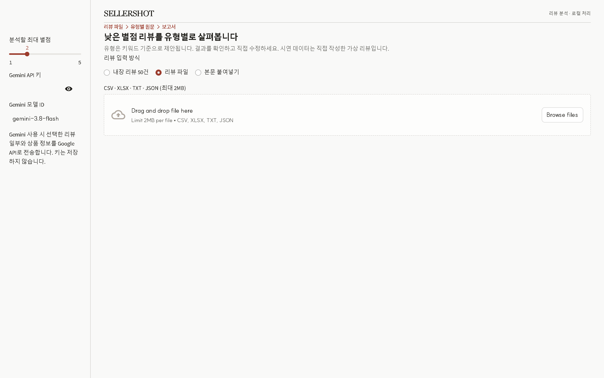
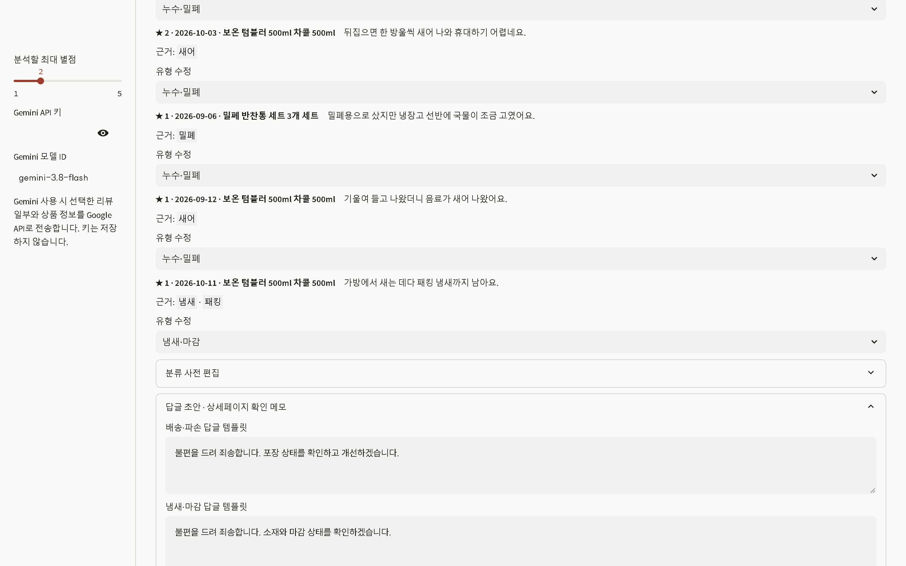
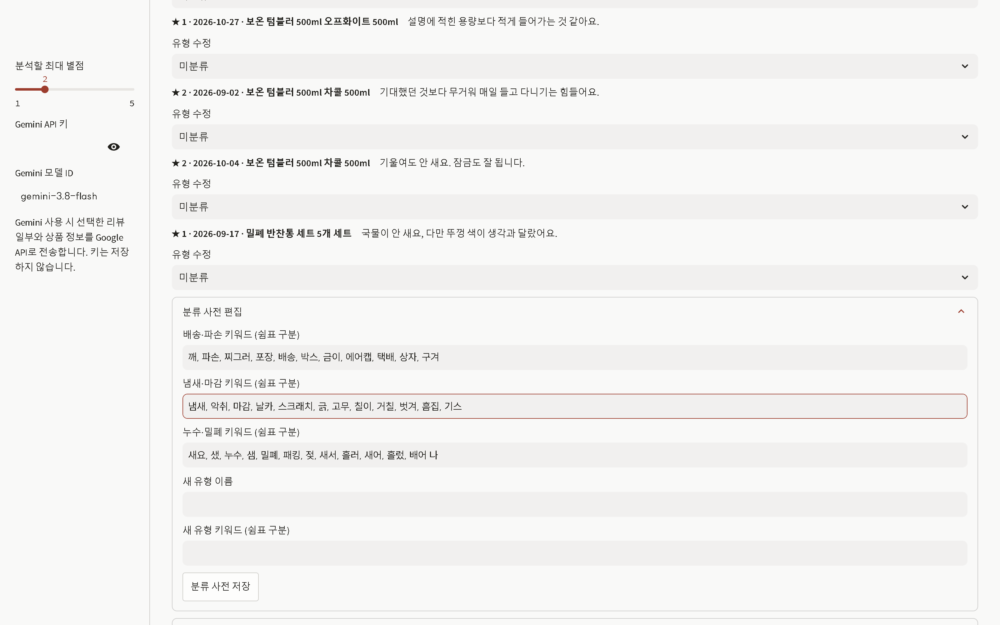

# SELLERSHOT

낮은 별점 리뷰를 불만 유형별로 모아 원문과 함께 살펴보는 로컬 리뷰 분석 도구입니다.

시연 데이터는 앱 제작자가 직접 쓴 가상 리뷰이며 실제 구매자 리뷰를 사용하지 않습니다.

## 화면

## 설치

Python 3.8 이상이 필요합니다. 압축을 푼 폴더에서 `run.cmd`(Windows) 또는 `./run.sh`(macOS/Linux)를 실행합니다. 첫 실행은 고정된 `requirements.txt`를 설치합니다.

## 사용 3단계

1. CSV·XLSX·TXT·JSON 파일을 선택하거나 리뷰 본문을 붙여 넣습니다.
2. 별점 범위와 유형별 원문·근거를 확인하고 필요한 분류를 수정합니다.
3. 엑셀 보고서와 답글 초안을 내려받습니다.

## 한계

분류는 로컬 키워드 규칙을 사용하며 문맥이나 반어를 완전히 이해하지 못할 수 있습니다. 근거 키워드와 원문을 직접 확인하세요. 작성일·상품·옵션 필터는 해당 열이 제공된 경우에만 쓸 수 있습니다. Gemini 기능은 사용자가 선택한 리뷰 일부와 상품 정보를 Google API로 보내며, 키는 저장하지 않습니다.

## 맞춤 제작 범위

공개판: 파일 입력, 로컬 분류, 분류 사전 편집, 엑셀 보고서, 답글 템플릿.

맞춤 제작: 쇼핑몰 API 자동 수집, 업종별 분류 사전 구축, 사내 대시보드 연동, 답글 자동 게시.

문의: kenlauhel8@gmail.com

## 라이선스

MIT + Commons Clause. 개인·회사 업무 사용과 수정·공유를 허용하며 소프트웨어 판매는 제한합니다. 출처: https://github.com/maryworks/ai-work-tools
